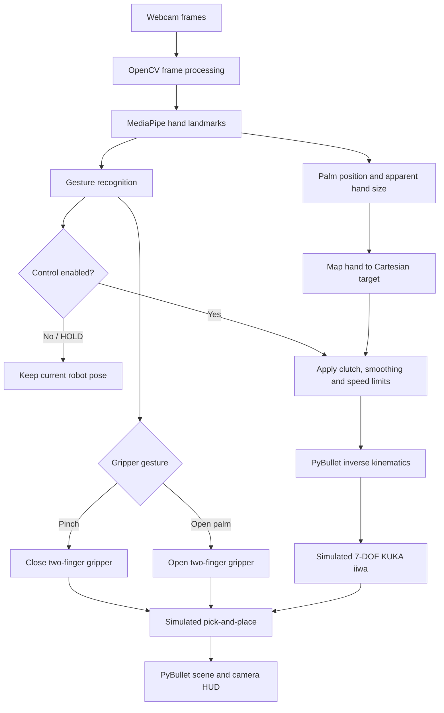

# Vision Teleoperation: Hand-Controlled KUKA iiwa Pick & Place

Control a **simulated 7-DOF KUKA iiwa** robot using a webcam and bare-hand gestures. MediaPipe tracks your hand, the palm is mapped to a Cartesian target, and PyBullet simulates inverse kinematics, a two-finger gripper, and pick-and-place objects.

> **Simulation only.** This project does not connect to a physical KUKA robot. Do not use it as a real-robot control system.

## Architecture diagram

Explore the repository architecture in the interactive diagram generated by GitDiagram:

[](https://gitdiagram.com/muneerahmedkhokhar53-wq/hand-teleoperation-kuka-iiwa/diagram.png?utm_source=chatgpt.com)

## Working workflow diagram

This workflow shows how webcam hand tracking becomes a motion target for the simulated robot, including the safety-oriented HOLD/clutch controls and gripper gestures.



**Main modules:** `teleoperation.py` runs the webcam/control loop, `hand_tracker.py` extracts hand landmarks and gestures, and `robot_sim.py` simulates the arm, gripper, objects, and inverse kinematics.

## Features

- Full-palm position control, with apparent hand size used as a depth signal
- Fist clutch, pinch-to-close, and open-palm-to-release gestures
- PyBullet robot and physically simulated gripper
- Target smoothing, workspace clamping, and speed-limited target updates
- Startup HOLD state and live camera HUD

## Requirements

- **Recommended: 64-bit Python 3.11**. The dependency set is pinned for the legacy MediaPipe `mp.solutions.hands` API used by this project.
- Windows, macOS, or Linux desktop with GUI support
- Webcam for full teleoperation
- Working display/GUI support for PyBullet and OpenCV

The standalone simulator does not require a webcam, but it still requires the Python packages and a graphical session.

## Clean installation

### Windows (PowerShell)

Open PowerShell in the folder where you keep projects:

```powershell
git clone https://github.com/muneerahmedkhokhar53-wq/hand-teleoperation-kuka-iiwa.git
Set-Location hand-teleoperation-kuka-iiwa

# Confirm that the Python launcher can find Python 3.11.
py -3.11 --version

# Create and activate a project-specific environment.
py -3.11 -m venv .venv
.\.venv\Scripts\Activate.ps1

python -m pip install --upgrade pip
python -m pip install -r requirements.txt
python -m pip check
```

If PowerShell blocks environment activation, you can avoid changing execution policy and invoke the environment's Python directly:

```powershell
.\.venv\Scripts\python.exe -m pip install --upgrade pip
.\.venv\Scripts\python.exe -m pip install -r requirements.txt
.\.venv\Scripts\python.exe -m pip check
```

If `py -3.11` is unavailable, install **64-bit Python 3.11** first, then reopen PowerShell. Avoid using a very new Python release until you have verified wheel availability for every dependency.

### macOS / Linux

```bash
git clone https://github.com/muneerahmedkhokhar53-wq/hand-teleoperation-kuka-iiwa.git
cd hand-teleoperation-kuka-iiwa
python3.11 -m venv .venv
source .venv/bin/activate
python -m pip install --upgrade pip
python -m pip install -r requirements.txt
python -m pip check
```

On Linux, a desktop session and camera permissions are required for the full webcam app. Headless/SSH environments without GUI forwarding cannot display the PyBullet GUI.

## Verify the install

Run these commands from the repository root with the virtual environment active:

```powershell
python -c "import cv2, mediapipe, numpy, pybullet, pybullet_data; print('OpenCV', cv2.__version__); print('MediaPipe', mediapipe.__version__); print('NumPy', numpy.__version__); print('PyBullet import OK')"
python -c "import mediapipe as mp; assert hasattr(mp, 'solutions'); print('MediaPipe Hands API OK')"
python -m compileall -q teleoperation.py hand_tracker.py robot_sim.py
```

If all three commands complete without errors, imports, the expected MediaPipe API, and Python syntax passed these checks. This is not a full simulation or webcam test.

## Run regression tests

From the repository root with the project environment active:

```powershell
python -m unittest discover -s tests -v
```

These tests cover gesture-state reset behavior, deferred depth calibration, Cartesian target speed limiting, finite hand-to-robot mapping, and workspace constraints. They do not replace interactive webcam or PyBullet task testing.

## Launch

### Full hand-controlled simulation

```powershell
python teleoperation.py
```

Two windows should appear: the PyBullet scene and the camera/HUD window. The arm starts in **HOLD**. Press `SPACE` in the camera window to enable hand control.

### Simulator-only smoke test (no webcam)

```powershell
python robot_sim.py
```

Click the PyBullet window before using its keyboard controls.

## Controls

### Camera / teleoperation window

| Key or gesture | Action |
|---|---|
| `SPACE` | Hold / resume control |
| Fist | Clutch; hold the robot pose while repositioning your hand |
| Pinch (thumb + index) | Close the gripper |
| Open palm | Open the gripper |
| `R` | Reset robot and scene |
| `N` | Respawn cubes |
| `D` | Toggle depth control |
| `C` | Calibrate neutral depth |
| `H` | Toggle HUD |
| `Q` / `ESC` | Quit |

### Simulator-only window

| Key | Action |
|---|---|
| `E` / `D` | Enable / disable motion |
| `G` / `C` | Open / close gripper |
| `R` | Reset |
| `I` / `K` | Move target along X |
| `J` / `L` | Move target along Y |
| `U` / `O` | Move target along Z |
| `Q` | Quit |

## Troubleshooting

- **`py -3.11` not found:** install 64-bit Python 3.11 and reopen the terminal.
- **MediaPipe has no `solutions` attribute:** confirm the active interpreter is the project virtual environment and reinstall the pinned requirements.
- **Camera cannot open:** close apps using the webcam, check Windows camera privacy permissions, and change `CAMERA_INDEX` in `hand_tracker.py` if needed.
- **PyBullet GUI fails to open:** run locally in a desktop session with working graphics drivers; a headless terminal may not support GUI mode.
- **Robot does not move:** press `SPACE`, keep your hand visible, and release the fist clutch.
- **Jittery tracking:** improve lighting, keep the hand in frame, and use a simple background.
- **Pip cannot find a compatible wheel:** verify that Python is 64-bit and 3.11, then update pip in the active virtual environment.

## Project structure

```text
hand-teleoperation-kuka-iiwa/
├── teleoperation.py   # Webcam loop, hand mapping, controls, HUD
├── hand_tracker.py    # MediaPipe landmarks and gesture recognition
├── robot_sim.py       # PyBullet robot, gripper, objects, inverse kinematics
├── requirements.txt   # Pinned runtime dependencies
├── LICENSE
└── README.md
```

## Limitations and responsible use

- This is a simulation and is not certified or safety-rated for real equipment.
- Apparent hand size is only an approximate depth cue; it is not metric depth sensing.
- Gesture recognition and inverse kinematics can fail in difficult lighting or near workspace limits.
- A successful package install or syntax check does not prove that pick-and-place works reliably. Run the GUI and test the task manually.

## License

Released under the [MIT License](LICENSE).
